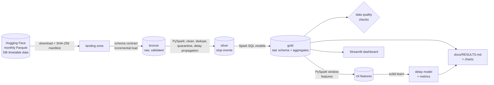

# 🚆 Deutsche Bahn Punctuality Lakehouse

[](https://github.com/AayushKaushik07/db-punctuality-lakehouse/actions/workflows/ci.yml)


An end-to-end data project on **real Deutsche Bahn timetable and delay data**: a PySpark
**medallion lakehouse** (bronze → silver → gold) on **Delta Lake**, a dimensional model and
analytics in **Spark SQL**, automated **data quality checks**, a leak-free **machine learning**
model that predicts late arrivals, and a **Streamlit** dashboard — tested, containerised and
running in **CI**.

> **Business questions**
> 1. How punctual are German trains really — by train type, station, hour and weekday?
> 2. *Where* do trains lose time? Which stretches between stations add the most delay per hour of travel?
> 3. Do my numbers agree with the punctuality figures Deutsche Bahn publishes?
> 4. Can we predict, before the day starts, which arrivals will be 6+ minutes late?

**Results:** see [`docs/RESULTS.md`](docs/RESULTS.md) — generated by the pipeline itself, so every
number and chart comes straight from the data.

### Key findings (November 2024 – October 2025, ~24 million stop events)

- **Only 55% of long-distance arrivals were punctual** (less than 6 min late) over the year, against 76% for
  regional trains and 88% for the S-Bahn; 5.2% of all scheduled stops were cancelled.
- **Clear seasonality:** long-distance punctuality was best in January 2025 (61%) and fell to its low in
  October 2025 (46%); the 7-day average peaks over Christmas and hits its minimum in early July 2025.
- **Consistent with DB's official statistics:** long-distance punctuality is 4.6–5.8 percentage points
  below DB's published figures in every compared period (H1 2025 and July–October 2025). The gap is
  stable, which points to a systematic coverage difference (only the ~100 biggest stations are in the
  dataset) rather than a calculation error.
- **Evening rush hour is worst** (18:00: 74% punctual vs. 91% at 04:00), Thursday is the worst weekday
  (77%) and Sunday the best (84%). Over the year the least punctual stations were Köln Messe/Deutz
  (platforms 11–12, 54%), Hamm, München Hbf and Osnabrück; the most punctual were Berlin's S-Bahn
  platforms (96%).
- **Where time is lost:** per hour of scheduled running time, the worst stretches are München Ost ↔
  Pasing, the Ruhr area (Essen – Dortmund – Düsseldorf – Duisburg) and Frankfurt – Hanau.
- **The delay model** (gradient boosting, trained on Nov 2024 – Sep 2025, tested on October 2025) reaches
  ROC-AUC 0.79 against 0.72 for a no-ML baseline; among the 20% riskiest arrivals it flags, 60% are
  actually late (base rate 28%).


---

## Architecture



| Layer | What it holds | Key techniques |
|---|---|---|
| **Landing** | Monthly files exactly as downloaded | Retries, checksum manifest |
| **Bronze** | Raw rows with a guaranteed schema | Schema contract, idempotent partition overwrite, ingestion audit log |
| **Silver** | Clean, de-duplicated stop events | Validation rules + quarantine table, de-duplication with window functions, journey reconstruction, delay gained per segment (`LAG` over each journey) |
| **Gold** | Star schema + business aggregates | Spark SQL: CTEs, `GROUPING SETS`, window functions (`RANK`, `LAG`, moving averages), `PERCENTILE_APPROX`, `STACK` unpivot |
| **ML** | Features, model, metrics | Rolling features that only look at past days, time-based split, baseline vs. two models |

More detail, including the data model and design decisions: [`docs/ARCHITECTURE.md`](docs/ARCHITECTURE.md).

## Tech stack — and where to find it

| Skill | In this repo |
|---|---|
| **Python** | Package `src/dbpipe/` with CLI, config, logging, type hints |
| **PySpark** | [`transform/silver.py`](src/dbpipe/transform/silver.py), [`ml/features.py`](src/dbpipe/ml/features.py), [`ingest/bronze.py`](src/dbpipe/ingest/bronze.py) |
| **SQL** | [`sql/gold/`](sql/gold) (9 models) and [`sql/analysis/`](sql/analysis) (gaps-and-islands, top-N per group, `FIRST_VALUE`/`LAST_VALUE`, `NTILE`) |
| **Delta Lake** | Storage format for all tables, `replaceWhere` for idempotent re-runs ([`lakehouse.py`](src/dbpipe/lakehouse.py)) |
| **Data modeling** | Star schema: `fct_stop_events`, `dim_station`, `dim_date` (with German public holidays), `dim_train_type` |
| **Data quality** | Schema contract, quarantine, 60 automated checks on the 12-month run, with severities ([`quality.py`](src/dbpipe/quality.py)) |
| **Machine learning** | scikit-learn pipelines, gradient boosting, permutation importance, calibration ([`ml/train.py`](src/dbpipe/ml/train.py)) |
| **Statistics** | Percentiles, moving averages, lift, ROC/PR-AUC, Brier score |
| **Visualisation** | Streamlit + Plotly dashboard ([`dashboard/app.py`](dashboard/app.py)), auto-generated report charts |
| **Testing** | pytest: unit tests per transformation, a data-leakage test, an end-to-end pipeline test |
| **DevOps** | Docker, Docker Compose, Makefile, GitHub Actions CI (lint → tests → Delta pipeline → Docker build) |

## Quick start

```bash
git clone https://github.com/AayushKaushik07/db-punctuality-lakehouse.git
cd db-punctuality-lakehouse
docker compose run --rm pipeline      # download 12 months (~1.25 GB) + run the whole pipeline
docker compose up dashboard           # open http://127.0.0.1:8501
```

For a quicker first try, process two months only:
`docker compose run --rm -e DBPIPE_MONTHS=2025-09,2025-10 pipeline` (~200 MB, a few minutes).

Only Docker is needed. Running without Docker, on Windows, choosing other months, and
troubleshooting are covered step by step in **[`docs/SETUP.md`](docs/SETUP.md)**.

Want to see it work in about a minute without downloading anything? `make sample-run` runs
the full pipeline on a small **synthetic** sample with the same schema (used for tests and CI
only — never for results).

## How punctuality is measured

Following Deutsche Bahn's operational definition:

- a stop is **punctual** if the train **arrives less than 6 minutes late**;
- punctuality is measured at **arrivals** (departure-only origin stops are not counted);
- **cancelled** stops are **excluded** from punctuality and reported separately as a cancellation rate.

## Data quality

Real data is messy, and this dataset documents its own issues (hours fetched twice, schema
changes between releases, local timestamps without a time zone). The pipeline handles them
explicitly:

| Problem | How it is handled |
|---|---|
| Timestamps stored in **nanoseconds** as German clock time (Spark can't read this type) | Read as numbers and converted in the schema contract so that 23:58 stays 23:58, also in the night the clocks go back; covered by a regression test |
| `train_line_ride_id` is a **recurring timetable pattern**, not one journey (discovered on the real data) | Journeys are rebuilt from the stop id (`<pattern>-<trip start>-<stop no>`); a quality check fails if segments start and end at the same station |
| Several station IDs share one name (S-Bahn / lower-level platforms, e.g. three "Berlin Hauptbahnhof") | `dim_station` uses the more specific platform name and falls back to adding the ID, so every display name is unique |
| Each monthly file contains a few hundred stops from the neighbouring month | Counted in the run metrics and left to the right month's file instead of distorting the first day's KPIs |
| Upstream schema changes | Schema contract: missing required column → load fails with a clear message; new optional columns → filled with NULL; unknown columns → dropped and logged |
| Duplicate records | De-duplicated per stop id, keeping the most complete record |
| Invalid rows | Moved to `silver.quarantine` with the reason(s), never silently dropped. The largest group on the real data: ~13,800 delay updates whose timetable entry is missing in the source (about 73% of them from just three days: 24 Nov 2024, 5 Jun 2025 and 31 Jul 2025) |
| Re-running a month | Partition replace (`replaceWhere`) → no duplicates, other months untouched |
| Unchanged files | Skipped on re-run via SHA-256 comparison (incremental load) |
| Wrong results | 60 checks after every 12-month run: 13 check types, several of them repeated per month or per published DB period (row counts, uniqueness, referential integrity, value ranges, comparison with DB's published numbers); errors stop the pipeline |

## The model

**Question:** what is the probability that a scheduled arrival will be at least 6 minutes late?

- **Features only use information available before the day starts** — station and route late
  rates over the previous 7 days, the station's historical rate at that hour, the network's rate
  the day before, calendar and holiday flags, train type, position in the route. A unit test
  proves that no feature for day *D* uses data from day *D*.
- **Time-based split:** trained on November 2024 – September 2025, tested on October 2025 (never a random split for time data).
- **Compared against a no-ML baseline** (the station's historical late rate at that hour), plus a
  logistic regression and a gradient-boosting model.
- Reported with ROC-AUC, PR-AUC, Brier score and a practical metric: *if you flag the 20% riskiest
  arrivals, what share are actually late?*

## Project structure

```
├── config/pipeline.yaml        # months, paths, thresholds (all overridable by env vars)
├── src/dbpipe/
│   ├── cli.py                  # python -m dbpipe <stage>
│   ├── ingest/                 # download, schema contract, bronze load
│   ├── transform/              # silver (PySpark), gold (runs sql/gold/*.sql)
│   ├── quality.py              # data quality checks
│   ├── ml/                     # features (PySpark), training + evaluation (scikit-learn)
│   ├── report.py               # charts + docs/RESULTS.md
│   └── query.py                # ad-hoc Spark SQL on the gold tables
├── sql/gold/                   # the gold data model, one file per table
├── sql/analysis/               # analysis queries you can run with `python -m dbpipe query`
├── dashboard/app.py            # Streamlit dashboard
├── reference/                  # DB's published punctuality (for validation)
├── tests/                      # pytest suite (unit + end-to-end)
├── docs/                       # setup guide, architecture, data dictionary, results
├── Dockerfile, docker-compose.yml, Makefile
└── .github/workflows/ci.yml
```

## Limitations

- Until October 2025 the dataset covers only the **~100 biggest stations**; from November 2025 all
  stations. Big hubs tend to be less punctual, so station-level numbers before November 2025 are
  not representative of the whole network.
- A "segment" is the stretch between two consecutive **covered** stations, which is not always two
  adjacent stations: segments range from 10 minutes to over 3 hours. Hotspots are therefore ranked by
  the **median delay gained per scheduled hour**, since longer stretches naturally collect more delay.
- Regional line numbers are not unique across Germany (several regions have an "RE1").
- The dataset contains non-DB operators, so it can't match DB's own figures exactly — the
  comparison is a plausibility check, not an audit.
- scikit-learn trains in memory, so the training set is a reproducible random sample (`ml.max_rows`).
  At larger scale the same features could be trained with Spark MLlib.

## Data source & credits

Data by **Deutsche Bahn**, licensed [CC BY 4.0](https://creativecommons.org/licenses/by/4.0/),
collected and published by Piet Brömmel in
[piebro/deutsche-bahn-data](https://github.com/piebro/deutsche-bahn-data)
([Hugging Face](https://huggingface.co/datasets/piebro/deutsche-bahn-data)).
Official punctuality figures: [deutschebahn.com](https://www.deutschebahn.com/de/konzern/konzernprofil/zahlen_fakten/puenktlichkeitswerte-6878476).
This project is not affiliated with Deutsche Bahn.

Code: MIT License — © Aayush Kaushik
