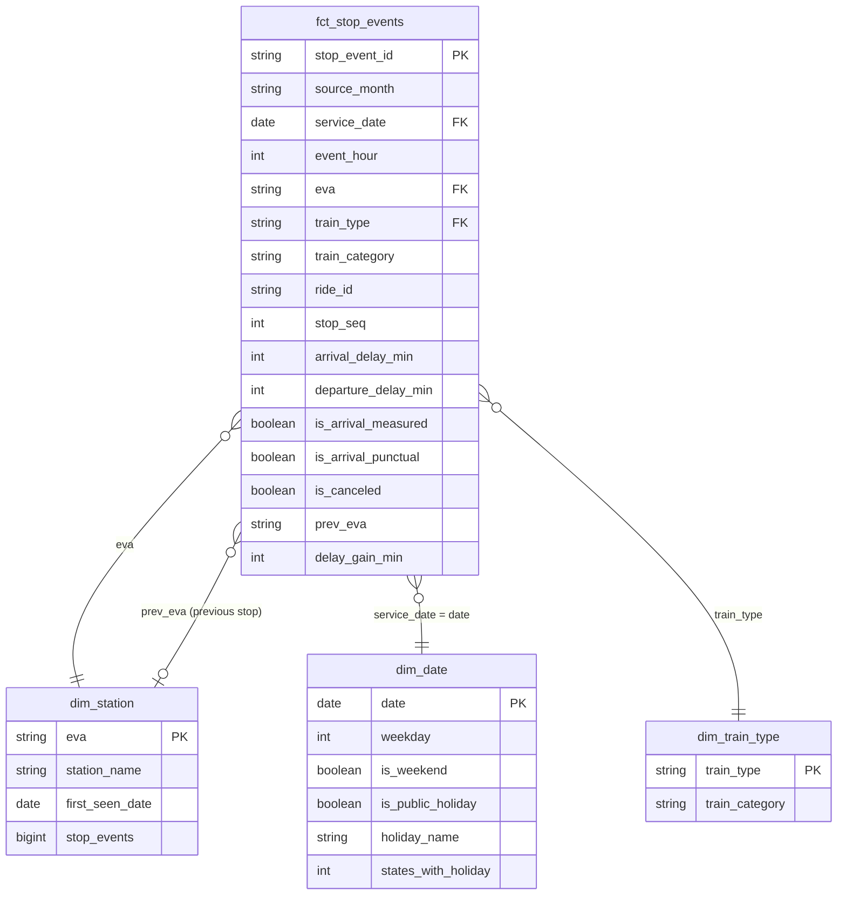

# Architecture & design decisions

## Pipeline stages

| # | Stage | Engine | Input → Output | Re-run behaviour |
|---|---|---|---|---|
| 1 | `download` | Python (`huggingface_hub`) | Hugging Face → `data/landing/` | skips files already present; `--force` re-downloads |
| 2 | `bronze` | PySpark | landing → `bronze.stop_events` | skips months whose SHA-256 is unchanged; replaces the month's partition otherwise |
| 3 | `silver` | PySpark | bronze → `silver.stop_events`, `silver.quarantine`, `silver._run_metrics` | replaces the configured months' partitions |
| 4 | `gold` | Spark SQL (+ Python for 2 dims) | silver → star schema + aggregates | full rebuild (small tables, always consistent) |
| 5 | `quality` | PySpark | all layers → `gold.dq_results` (append) | fails the run on any ERROR check |
| 6 | `features` | PySpark | gold → `gold.ml_features`, `gold.ml_training_set` | full rebuild |
| 7 | `train` | scikit-learn | training set → model, `metrics.json`, charts | retrains |
| 8 | `report` | pandas + matplotlib | gold + metrics → `docs/RESULTS.md`, `docs/images/` | regenerates |

`python -m dbpipe run` runs stages 2–8; `make all` adds the download.

## Data model (gold)

**Grain of the fact table:** one scheduled stop of one train ride at one station.

Aggregates built on top (see [DATA_DICTIONARY.md](DATA_DICTIONARY.md)): `agg_punctuality_daily`,
`agg_hourly_profile`, `agg_station_monthly`, `agg_segment_hotspots`, `agg_line_reliability`,
`agg_official_comparison`, `agg_delay_distribution`.

## Design decisions

**Why a lakehouse (Delta Lake) instead of a database?**
The source is Parquet files published monthly. Keeping everything as files in a medallion
layout (bronze/silver/gold) is how Databricks/Azure data platforms work. Delta Lake adds what
plain Parquet lacks: atomic writes, schema enforcement, and `replaceWhere` to overwrite exactly
one month. A failed run never leaves half-written data behind.

**Why PySpark for a dataset that fits on a laptop?**
One month of all-station data is ~600 MB of compressed Parquet (millions of rows), and a year is
several GB. The code is written the way it would run on a cluster: no `collect()` of large data,
window functions instead of Python loops, partitioned writes. Changing `spark.master` is
enough to scale out.

**Why Spark SQL files for gold instead of DataFrame code?**
Business logic in SQL is easier to review for analysts and closer to what dbt projects look
like. Each file is one table, runs in file order, and later files can use earlier tables as
views (`gold_<name>`). Parameters such as the 6-minute threshold come from the config
(`${punctual_threshold_min}`), so there are no magic numbers in the SQL.

**Why a quarantine table instead of dropping bad rows?**
Dropped rows are invisible. Quarantined rows keep the reason, can be counted and monitored
(`quarantine_rate` check) and can be re-processed if a rule was too strict.

**Why is `delay_in_min` recomputed?**
The dataset ships its own delay column. Recomputing it from planned vs. changed timestamps
gives separate arrival and departure delays (needed for delay propagation) and acts as a
consistency check (`delay_agreement_rate`).

**Why a time-based split and a no-ML baseline?**
A random split would let the model learn from days that come *after* the test days. The
baseline (historical station-hour late rate) shows how much the model actually adds; a model
that can't beat a simple rule isn't worth deploying.

**Why scikit-learn and not Spark MLlib?**
Features are computed in Spark (the expensive part, over all rows). The model trains on a
reproducible sample of up to 1.5 M rows, which scikit-learn handles in seconds, and
`HistGradientBoostingClassifier` is a stronger default than MLlib's GBT. With more data the
same feature table could feed MLlib unchanged.

**Why two storage formats (`delta` and `parquet`)?**
Delta needs extra jars that Spark downloads from Maven on first use. Unit tests use plain
Parquet so they run offline and fast; CI and Docker run the real Delta path. The code is the
same apart from the write options in `lakehouse.py`.

## Timezones

All source timestamps are German local time without an offset (as delivered by the DB API).
Spark's session time zone is set to `Europe/Berlin`, so hours and dates are interpreted
as local time, which is what "a train at 08:00" means to a passenger. Daylight-saving-time
changes are therefore visible as a 23- or 25-hour day, which is correct for this analysis.
