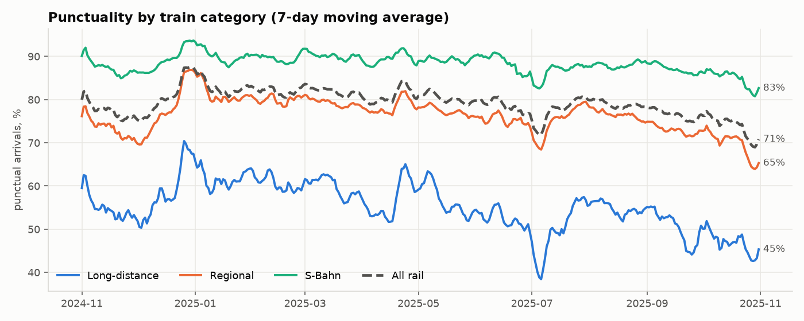
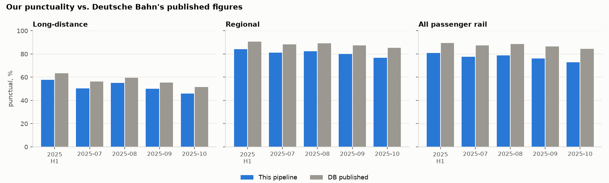
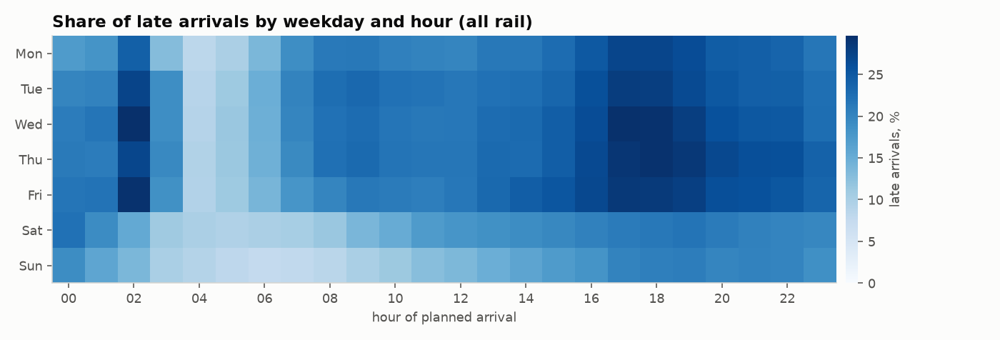
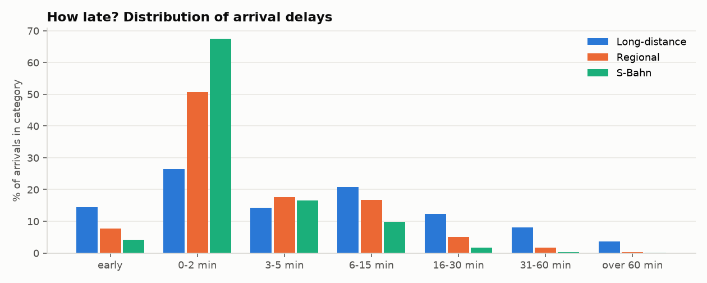
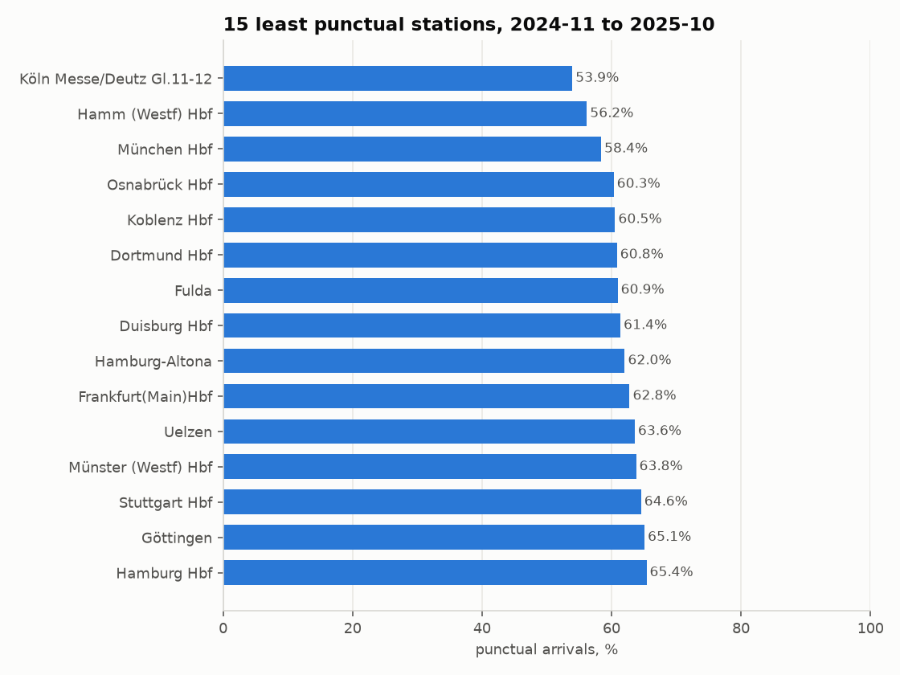
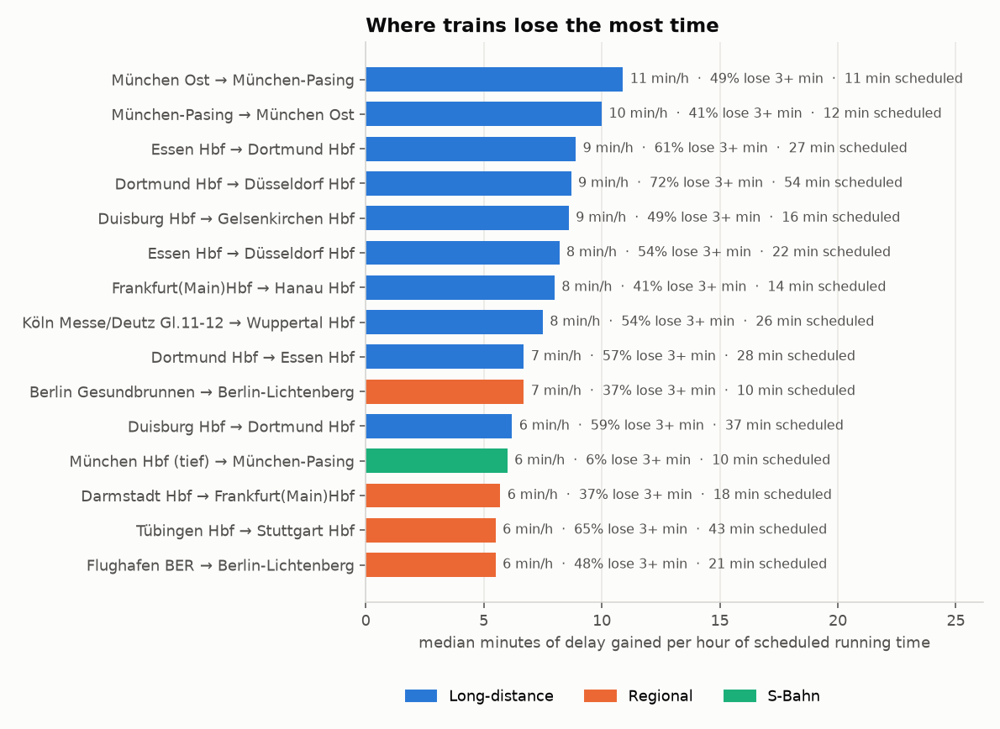
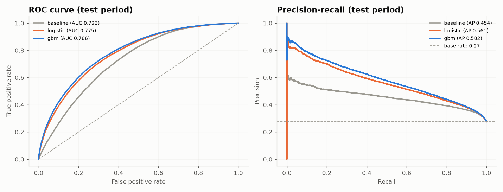
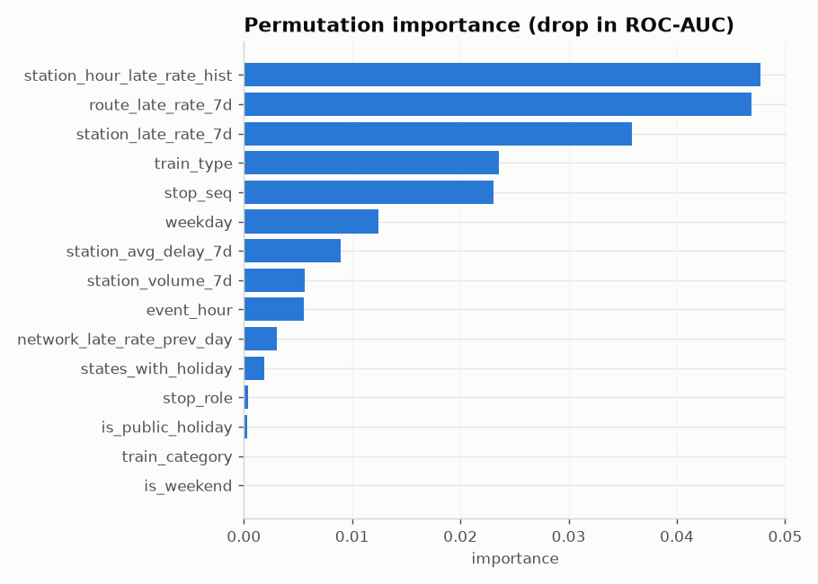
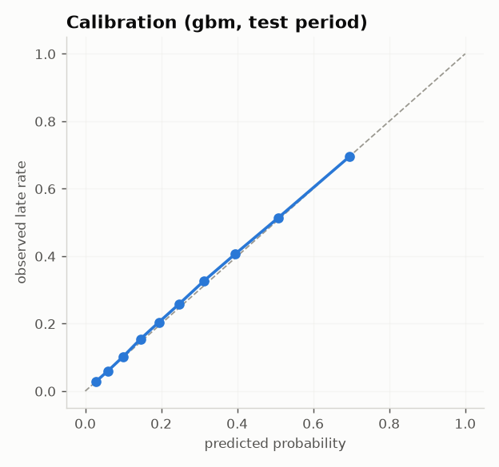

# Results

_Generated automatically by `python -m dbpipe report` on 2026-09-30 17:15. Months: 2024-11, 2024-12, 2025-01, 2025-02, 2025-03, 2025-04, 2025-05, 2025-06, 2025-07, 2025-08, 2025-09, 2025-10. Data: Deutsche Bahn via [piebro/deutsche-bahn-data](https://huggingface.co/datasets/piebro/deutsche-bahn-data) (CC BY 4.0)._

## 1. Headline KPIs

| Category | Measured arrivals | Punctuality | Cancelled stops |
|---|---|---|---|
| Long-distance | 2,160,499 | 55.1% | 6.6% |
| Regional | 7,113,122 | 76.1% | 4.2% |
| S-Bahn | 7,967,286 | 88.1% | 6.0% |
| All rail | 17,240,907 | 79.0% | 5.2% |

Punctual = arrival less than 6 minutes late (Deutsche Bahn definition). Cancelled stops are excluded from punctuality and reported separately.

Punctuality (%) by month:

| Month | Long-distance | Regional | S-Bahn | All rail |
|---|---|---|---|---|
| 2024-11 | 53.9 | 72.4 | 86.6 | 76.6 |
| 2024-12 | 60.5 | 79.1 | 89.7 | 81.6 |
| 2025-01 | 61.3 | 80.4 | 89.5 | 82.2 |
| 2025-02 | 60.2 | 79.8 | 89.6 | 81.9 |
| 2025-03 | 59.7 | 79.0 | 89.8 | 81.6 |
| 2025-04 | 56.0 | 77.8 | 88.9 | 80.3 |
| 2025-05 | 56.4 | 77.0 | 89.3 | 80.1 |
| 2025-06 | 51.8 | 74.9 | 88.1 | 78.1 |
| 2025-07 | 50.4 | 75.3 | 86.3 | 77.5 |
| 2025-08 | 55.0 | 76.2 | 88.1 | 78.8 |
| 2025-09 | 50.0 | 72.5 | 86.6 | 76.2 |
| 2025-10 | 45.9 | 68.6 | 84.0 | 72.8 |

## 2. Validation against Deutsche Bahn's published numbers

| period | segment | ours % | DB published % | difference (pp) |
|---|---|---|---|---|
| 2025-H1 | fernverkehr | 57.62 | 63.4 | -5.78 |
| 2025-H1 | gesamt | 80.73 | 89.5 | -8.77 |
| 2025-H1 | regio | 84.04 | 90.6 | -6.56 |
| 2025-07 | fernverkehr | 50.43 | 56.1 | -5.67 |
| 2025-07 | gesamt | 77.46 | 87.4 | -9.94 |
| 2025-07 | regio | 81.11 | 88.1 | -6.99 |
| 2025-08 | fernverkehr | 55.01 | 59.6 | -4.59 |
| 2025-08 | gesamt | 78.79 | 88.4 | -9.61 |
| 2025-08 | regio | 82.41 | 89.2 | -6.79 |
| 2025-09 | fernverkehr | 50.04 | 55.3 | -5.26 |
| 2025-09 | gesamt | 76.15 | 86.4 | -10.25 |
| 2025-09 | regio | 79.95 | 87.2 | -7.25 |
| 2025-10 | fernverkehr | 45.89 | 51.5 | -5.61 |
| 2025-10 | gesamt | 72.85 | 84.4 | -11.55 |
| 2025-10 | regio | 76.73 | 85.2 | -8.47 |

DB's figures: monthly values from DB's punctuality page and the H1 (January–June) average from DB's 2025 interim report; for a half-year our arrivals are pooled over the same months. Months without a published DB value (see `reference/README.md`) are not compared.

Mean absolute gap: **7.5 percentage points**. Gaps are expected: until 2025-10 the dataset only covers the ~100 biggest stations (hubs are typically less punctual than small stations), it includes non-DB operators, and DB uses internal data for every stop.

## 3. When are trains late?

- Least punctual hour: **18:00** (73.5% punctual); most punctual: **04:00** (91.0%).
- Least punctual weekday: **Thu** (76.9%); most punctual: **Sun** (84.4%).

## 4. Stations and segments

Least punctual stations, 2024-11 to 2025-10, pooled over all months (min. 500 arrivals per month; `worst_month` = the station's least punctual month):

| rank | station_name | measured_arrivals | punctuality_pct | cancellation_pct | avg_arrival_delay_min | worst_month |
|---|---|---|---|---|---|---|
| 1 | Köln Messe/Deutz Gl.11-12 | 22568 | 53.94 | 7.56 | 11.78 | 2024-11 |
| 2 | Hamm (Westf) Hbf | 102006 | 56.18 | 5.97 | 9.84 | 2025-10 |
| 3 | München Hbf | 110824 | 58.39 | 4.85 | 9.73 | 2025-10 |
| 4 | Osnabrück Hbf | 79976 | 60.33 | 3.56 | 8.42 | 2025-10 |
| 5 | Koblenz Hbf | 92409 | 60.55 | 5.88 | 8.4 | 2025-10 |
| 6 | Dortmund Hbf | 191744 | 60.83 | 5.77 | 8.45 | 2025-10 |
| 7 | Fulda | 76089 | 60.94 | 3.92 | 9.03 | 2025-10 |
| 8 | Duisburg Hbf | 211222 | 61.37 | 6.26 | 8.14 | 2025-10 |
| 9 | Hamburg-Altona | 34476 | 62.04 | 8.52 | 10.36 | 2025-10 |
| 10 | Frankfurt(Main)Hbf | 221692 | 62.79 | 7.43 | 7.72 | 2025-10 |

Segments where trains lose the most time, as median minutes of delay gained per hour of scheduled running time (between two consecutive covered stations; min. 200 trains and 10 scheduled minutes):

| hotspot_rank | from_station | to_station | main_train_category | observations | median_planned_min | median_gain_per_hour | median_delay_gain_min | pct_trains_gaining_3min |
|---|---|---|---|---|---|---|---|---|
| 1 | München Ost | München-Pasing | long_distance | 644 | 11 | 10.9 | 2 | 49.22 |
| 2 | München-Pasing | München Ost | long_distance | 665 | 12 | 10.0 | 2 | 40.6 |
| 3 | Essen Hbf | Dortmund Hbf | long_distance | 5999 | 27 | 8.9 | 4 | 60.81 |
| 4 | Dortmund Hbf | Düsseldorf Hbf | long_distance | 280 | 54 | 8.7 | 8 | 71.79 |
| 5 | Duisburg Hbf | Gelsenkirchen Hbf | long_distance | 368 | 16 | 8.6 | 2 | 48.91 |
| 6 | Essen Hbf | Düsseldorf Hbf | long_distance | 780 | 22 | 8.2 | 3 | 54.49 |
| 7 | Frankfurt(Main)Hbf | Hanau Hbf | long_distance | 7444 | 14 | 8.0 | 2 | 40.56 |
| 8 | Köln Messe/Deutz Gl.11-12 | Wuppertal Hbf | long_distance | 233 | 26 | 7.5 | 3 | 54.08 |
| 9 | Dortmund Hbf | Essen Hbf | long_distance | 5542 | 28 | 6.7 | 3 | 56.68 |
| 10 | Berlin Gesundbrunnen | Berlin-Lichtenberg | regional | 2540 | 10 | 6.7 | 2 | 36.61 |

## 5. Delay prediction model

Task: P(arrival delay >= 6 min) for a scheduled arrival, using only information available before the day starts. Time-based split: train 2024-11-08 → 2025-09-30 (1,345,380 rows), test 2025-10-01 → 2025-10-31 (127,797 rows). Late rate in the test period: 27.5%.

| model | ROC-AUC | PR-AUC | Brier | precision @ top 20% | lift @ top 20% |
|---|---|---|---|---|---|
| baseline | 0.723 | 0.454 | 0.1810 | 48.4% | 1.76x |
| logistic | 0.775 | 0.561 | 0.1611 | 58.3% | 2.12x |
| gbm | 0.786 | 0.582 | 0.1574 | 60.5% | 2.20x |

- Gradient boosting vs. the no-ML baseline: **+0.063 ROC-AUC**.
- Most important features: `station_hour_late_rate_hist`, `route_late_rate_7d`, `station_late_rate_7d`.
- Flagging the 20% riskiest arrivals catches 44% of all late arrivals.

## 6. Data quality (latest run)

60 checks: **60 passed**, 0 errors, 0 warnings.

Rows quarantined in silver, by reason:

| reason | rows | meaning |
|---|---|---|
| missing_planned_time | 13764 | delay update without its timetable entry (no scheduled time, train number or type); mostly a few days where the source is missing timetable data |
| delay_out_of_range | 1700 | delay above 24 h or more than 30 min early |
| departure_before_arrival | 64 | scheduled departure before scheduled arrival |
